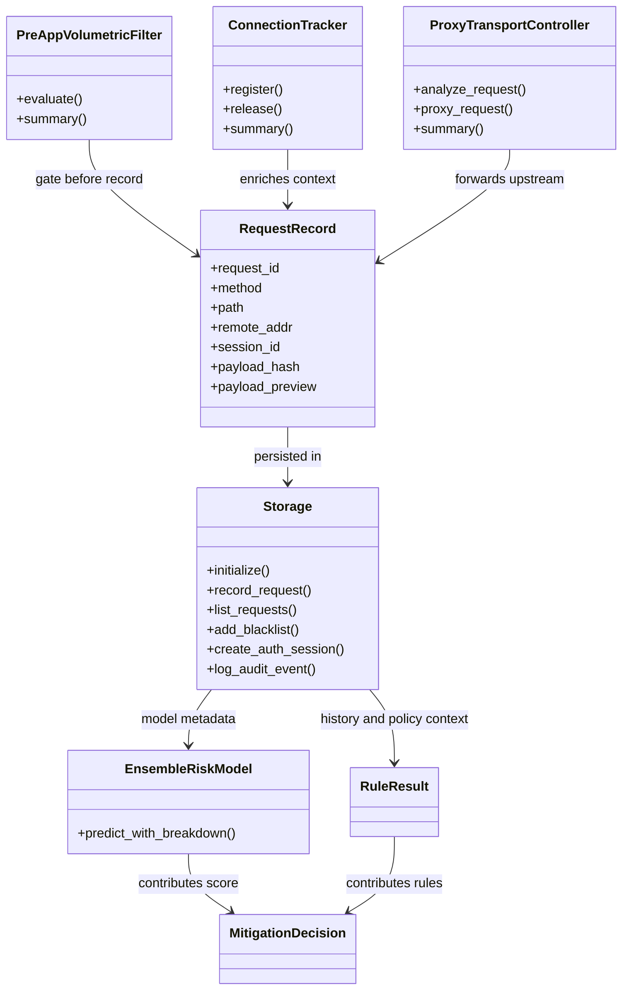
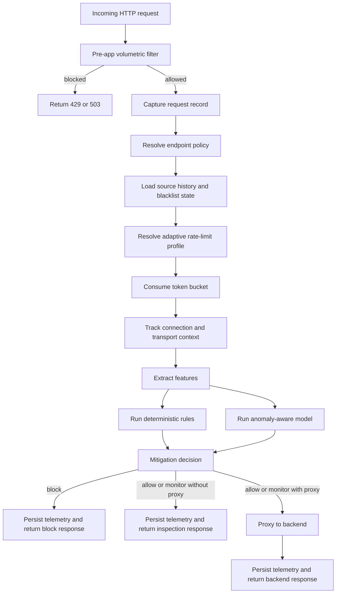
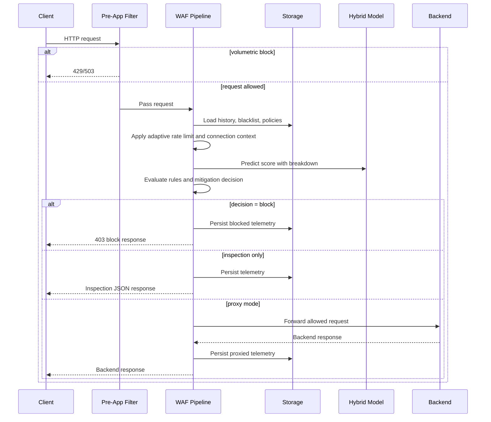
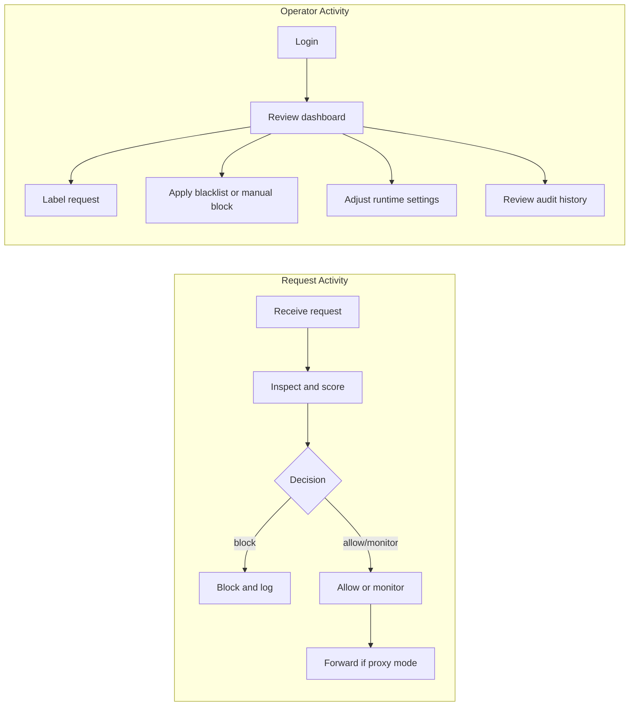
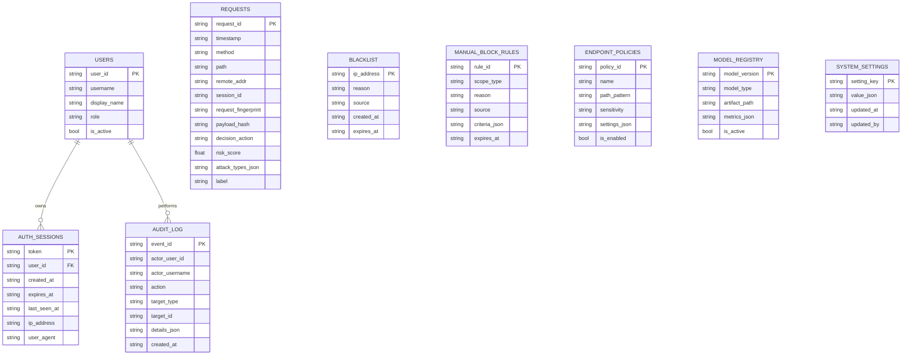
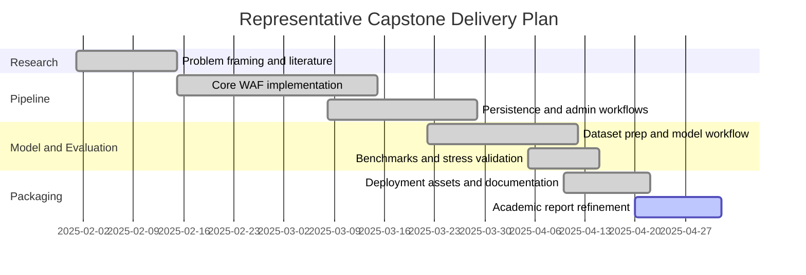

# Chapter 3: Requirements and Analysis

## 3.1 Introduction

This chapter converts the implemented AI-Based Web Application Firewall into a formal academic analysis chapter. The goal is not to describe an idealized or hypothetical product, but to document the system that actually exists in the repository and is supported by runnable evidence.

The chapter is grounded in three primary sources of truth:

- [README.md](C:/Users/tamat/OneDrive/Desktop/wafai/waf_project/README.md) for capabilities, runtime modes, and operator workflows
- [system_architecture.md](C:/Users/tamat/OneDrive/Desktop/wafai/waf_project/docs/system_architecture.md) for the architectural and control-plane design
- [reports](C:/Users/tamat/OneDrive/Desktop/wafai/waf_project/reports) for measured evaluation, benchmark, health, and stress-test evidence

This approach keeps the academic package aligned with the real project state. Any requirement or design statement in this chapter is therefore either directly implemented, explicitly marked as partially achieved, or identified as future work.

## 3.2 Evidence Baseline

The current repository supports the following validated project realities:

- a Flask-based WAF pipeline that can inspect, monitor, block, and proxy requests
- a React command center with authenticated viewer, analyst, and admin roles
- SQLite local persistence with PostgreSQL production-style support
- storage-backed token buckets with optional Redis-backed distributed rate limiting
- persistent request telemetry, labeling, export, retraining, and audit logging
- local and Docker benchmark evidence captured in machine-readable reports

The most important consequence of this evidence-first approach is that the report no longer claims theoretical performance or ML behavior that the repository has not demonstrated.

## 3.3 Functional Requirements

**Table 3.1. Functional requirements aligned to the implemented repository**

| ID | Requirement | Description | Current implementation evidence |
|---|---|---|---|
| FR-1 | Request interception | The system shall intercept HTTP requests before they reach the protected backend. | Implemented through `/inspect`, `/protected`, `/proxy`, and transparent proxy routing in [main.py](C:/Users/tamat/OneDrive/Desktop/wafai/waf_project/main.py). |
| FR-2 | Structured request normalization | The system shall normalize each request into a structured record containing identity, metadata, payload preview, and correlation fields. | Implemented by `RequestRecord` and `capture_request()` in [core/data_ingestion.py](C:/Users/tamat/OneDrive/Desktop/wafai/waf_project/core/data_ingestion.py). |
| FR-3 | Pre-application volumetric filtering | The gateway shall block obvious volumetric bursts before the main Flask route logic executes. | Implemented by `PreAppVolumetricFilter` and `VolumetricPreAppMiddleware` in [core/pre_app_filter.py](C:/Users/tamat/OneDrive/Desktop/wafai/waf_project/core/pre_app_filter.py). |
| FR-4 | Endpoint-aware rate limiting | The system shall enforce rate limits using token buckets that can vary by endpoint sensitivity and traffic risk. | Implemented through [core/rate_limiter.py](C:/Users/tamat/OneDrive/Desktop/wafai/waf_project/core/rate_limiter.py), [core/adaptive_rate_limit.py](C:/Users/tamat/OneDrive/Desktop/wafai/waf_project/core/adaptive_rate_limit.py), and [core/endpoint_policy.py](C:/Users/tamat/OneDrive/Desktop/wafai/waf_project/core/endpoint_policy.py). |
| FR-5 | Deterministic rule evaluation | The system shall detect known attack families through explainable rules. | Implemented in [core/rule_engine.py](C:/Users/tamat/OneDrive/Desktop/wafai/waf_project/core/rule_engine.py) for blacklist hits, manual blocks, SQLi, XSS, traversal, brute force, DDoS-style pressure, and automation signals. |
| FR-6 | Behavioral feature extraction | The system shall extract numerical and Boolean security features from content, short-term history, transport hints, and source behavior. | Implemented in [core/feature_engineering.py](C:/Users/tamat/OneDrive/Desktop/wafai/waf_project/core/feature_engineering.py). |
| FR-7 | Anomaly-aware scoring | The system shall compute an anomaly-oriented risk score using a runtime model with a safe fallback. | Implemented in [core/ml_models.py](C:/Users/tamat/OneDrive/Desktop/wafai/waf_project/core/ml_models.py) using a heuristic fallback and optional Isolation Forest or Random Forest artifact. |
| FR-8 | Mitigation decisions | The gateway shall decide whether a request is allowed, monitored, or blocked. | Implemented by `MitigationDecision` and `decide_action()` in [core/mitigation.py](C:/Users/tamat/OneDrive/Desktop/wafai/waf_project/core/mitigation.py). |
| FR-9 | Protected reverse proxy forwarding | Requests that survive inspection shall be forwarded to the protected backend when proxy mode is active. | Implemented in `handle_security_pipeline()` and the upstream transport controller in [main.py](C:/Users/tamat/OneDrive/Desktop/wafai/waf_project/main.py) and [core/proxy_transport.py](C:/Users/tamat/OneDrive/Desktop/wafai/waf_project/core/proxy_transport.py). |
| FR-10 | Persistent telemetry | The system shall persist request decisions, scores, features, labels, and related operational data. | Implemented through the `requests`, `blacklist`, `model_registry`, `manual_block_rules`, `endpoint_policies`, `users`, `auth_sessions`, `audit_log`, and `system_settings` tables in [core/storage.py](C:/Users/tamat/OneDrive/Desktop/wafai/waf_project/core/storage.py). |
| FR-11 | Analyst command center | The project shall expose a dashboard for summary metrics, request review, threat inspection, and operational actions. | Implemented in [frontend/src/App.jsx](C:/Users/tamat/OneDrive/Desktop/wafai/waf_project/frontend/src/App.jsx) and served from `/dashboard/`. |
| FR-12 | Role-based access control | The project shall support authenticated access with differentiated user roles and session handling. | Implemented through [core/auth.py](C:/Users/tamat/OneDrive/Desktop/wafai/waf_project/core/auth.py), the `users` and `auth_sessions` tables, and the login/logout/admin routes in [main.py](C:/Users/tamat/OneDrive/Desktop/wafai/waf_project/main.py). |
| FR-13 | Blacklist and targeted block management | Analysts shall be able to block a source IP or create narrower manual block scopes such as signature, path, or session. | Implemented through `/api/blacklist`, `/api/manual-blocks`, and `/api/requests/<request_id>/blacklist` in [main.py](C:/Users/tamat/OneDrive/Desktop/wafai/waf_project/main.py). |
| FR-14 | Request review and labeling | Analysts shall be able to label captured requests and export reviewed telemetry for model work. | Implemented through `/api/requests/<request_id>/label`, [scripts/export_labeled_dataset.py](C:/Users/tamat/OneDrive/Desktop/wafai/waf_project/scripts/export_labeled_dataset.py), and the label workflow in the React UI. |
| FR-15 | Administrative governance | Administrators shall be able to manage runtime settings, endpoint policies, users, and audit history. | Implemented through `/api/admin/settings`, `/api/admin/security-scope`, `/api/admin/users`, and `/api/admin/audit` in [main.py](C:/Users/tamat/OneDrive/Desktop/wafai/waf_project/main.py). |
| FR-16 | Reproducible research workflow | The project shall support training, evaluation, benchmark generation, and evidence packaging. | Implemented through [scripts/train_model.py](C:/Users/tamat/OneDrive/Desktop/wafai/waf_project/scripts/train_model.py), [scripts/evaluate_model.py](C:/Users/tamat/OneDrive/Desktop/wafai/waf_project/scripts/evaluate_model.py), [scripts/benchmark_proxy.py](C:/Users/tamat/OneDrive/Desktop/wafai/waf_project/scripts/benchmark_proxy.py), and [scripts/generate_academic_results.py](C:/Users/tamat/OneDrive/Desktop/wafai/waf_project/scripts/generate_academic_results.py). |

## 3.4 Non-Functional Requirements

**Table 3.2. Non-functional requirements and current status**

| ID | Category | Requirement | Repository-aligned status |
|---|---|---|---|
| NFR-1 | Explainability | Security decisions should remain inspectable by analysts. | Achieved. Request details expose score breakdowns, rule hits, features, and decision explanations for privileged roles. |
| NFR-2 | Graceful degradation | The gateway should remain operational even if no trained ML artifact is available. | Achieved. The runtime model falls back to a heuristic model in [core/ml_models.py](C:/Users/tamat/OneDrive/Desktop/wafai/waf_project/core/ml_models.py). |
| NFR-3 | Persistence flexibility | The project should support a lightweight local database and a production-style relational backend. | Achieved. SQLite is the default and PostgreSQL is supported through [core/storage.py](C:/Users/tamat/OneDrive/Desktop/wafai/waf_project/core/storage.py) and [docs/deployment.md](C:/Users/tamat/OneDrive/Desktop/wafai/waf_project/docs/deployment.md). |
| NFR-4 | Rate-limit backend flexibility | The gateway should support both single-instance and distributed rate-limit state. | Achieved. Storage-backed and Redis-backed token buckets are both supported. |
| NFR-5 | Operational security | Authentication should protect privileged actions and preserve role separation. | Achieved. Passwords are PBKDF2-hashed and privileged routes are protected by role guards in [core/auth.py](C:/Users/tamat/OneDrive/Desktop/wafai/waf_project/core/auth.py). |
| NFR-6 | Data minimization | Persisted telemetry should avoid unrestricted raw payload storage when possible. | Largely achieved. The repository persists payload hashes and short previews rather than unrestricted raw request bodies. |
| NFR-7 | Portability | The project should run in multiple deployment modes without code rewrites. | Achieved. The repository supports local embedded mode, API-only mode, and Docker Compose mode. |
| NFR-8 | Auditability | Administrative actions should be attributable and reviewable. | Achieved. Privileged actions are persisted in the `audit_log` table and exposed through `/api/admin/audit`. |
| NFR-9 | Maintainability | The codebase should remain modular and externally configurable. | Achieved. Core logic is split across dedicated modules and runtime behavior is controlled through [config.py](C:/Users/tamat/OneDrive/Desktop/wafai/waf_project/config.py), environment variables, and runtime overrides. |
| NFR-10 | Reproducibility | Evaluation, benchmarks, and deployment evidence should be recoverable from the repository. | Achieved. Reports, scripts, and appendix commands are included in [reports](C:/Users/tamat/OneDrive/Desktop/wafai/waf_project/reports) and [appendices.md](C:/Users/tamat/OneDrive/Desktop/wafai/waf_project/docs/chapters/appendices.md). |
| NFR-11 | Performance transparency | Performance claims should be backed by measured latency and throughput reports. | Achieved, but the current performance target is not fully met. Actual benchmark evidence is stored in [academic_results.md](C:/Users/tamat/OneDrive/Desktop/wafai/waf_project/reports/academic_results.md), where average and P95 latency remain above the original success criteria. |

## 3.5 Software Stack

**Table 3.3. Software stack derived from the repository**

| Layer | Technology | Evidence in repository | Purpose |
|---|---|---|---|
| Backend framework | Flask 3 | [requirements.txt](C:/Users/tamat/OneDrive/Desktop/wafai/waf_project/requirements.txt) | WAF API, dashboard hosting, auth endpoints, admin APIs |
| HTTP client | requests | [requirements.txt](C:/Users/tamat/OneDrive/Desktop/wafai/waf_project/requirements.txt) | Upstream proxy forwarding |
| ML library | scikit-learn | [requirements.txt](C:/Users/tamat/OneDrive/Desktop/wafai/waf_project/requirements.txt) | Isolation Forest and Random Forest training and evaluation |
| Production WSGI server | Waitress | [requirements.txt](C:/Users/tamat/OneDrive/Desktop/wafai/waf_project/requirements.txt) | Production-style Python serving |
| PostgreSQL driver | psycopg[binary] | [requirements.txt](C:/Users/tamat/OneDrive/Desktop/wafai/waf_project/requirements.txt) | PostgreSQL persistence support |
| Redis client | redis | [requirements.txt](C:/Users/tamat/OneDrive/Desktop/wafai/waf_project/requirements.txt) | Distributed rate-limit state |
| Frontend library | React 18 | [frontend/package.json](C:/Users/tamat/OneDrive/Desktop/wafai/waf_project/frontend/package.json) | Analyst command center |
| Frontend build tool | Vite | [frontend/package.json](C:/Users/tamat/OneDrive/Desktop/wafai/waf_project/frontend/package.json) | Development server and SPA build pipeline |
| Container orchestration | Docker Compose | [docker-compose.production.yml](C:/Users/tamat/OneDrive/Desktop/wafai/waf_project/docker-compose.production.yml) | Production-style multi-service stack |
| Database service | PostgreSQL 16 | [docker-compose.production.yml](C:/Users/tamat/OneDrive/Desktop/wafai/waf_project/docker-compose.production.yml) | Production-style relational persistence |
| Cache / rate-limit state | Redis 7 | [docker-compose.production.yml](C:/Users/tamat/OneDrive/Desktop/wafai/waf_project/docker-compose.production.yml) | Distributed token-bucket backend |
| Edge serving | Nginx | [deploy/nginx](C:/Users/tamat/OneDrive/Desktop/wafai/waf_project/deploy/nginx/frontend.conf) and [waf-edge.conf](C:/Users/tamat/OneDrive/Desktop/wafai/waf_project/deploy/nginx/waf-edge.conf) | SPA serving and reverse-proxy edge layout |

## 3.6 Runtime and Hardware Context

The repository contains strong runtime evidence, but it does not persist the exact CPU, RAM, or disk characteristics of the workstation used to generate the benchmarks. To keep the report accurate, this section documents what can be proven directly and avoids inventing unrecorded hardware specifications.

**Table 3.4. Runtime context grounded in repository evidence**

| Context | Current evidence | Academic interpretation |
|---|---|---|
| Local development mode | [README.md](C:/Users/tamat/OneDrive/Desktop/wafai/waf_project/README.md) and [health_local.json](C:/Users/tamat/OneDrive/Desktop/wafai/waf_project/reports/health_local.json) | Validated on a developer workstation with SQLite and storage-backed rate limiting |
| Docker production-style mode | [docker-compose.production.yml](C:/Users/tamat/OneDrive/Desktop/wafai/waf_project/docker-compose.production.yml) and [health_docker.json](C:/Users/tamat/OneDrive/Desktop/wafai/waf_project/reports/health_docker.json) | Validated as a composed stack with PostgreSQL, Redis, Flask API, sample backend, and SPA |
| Frontend runtime | [frontend/package.json](C:/Users/tamat/OneDrive/Desktop/wafai/waf_project/frontend/package.json) | React SPA can run via Vite dev server or Nginx-served build artifacts |
| Benchmark environment | [academic_results.md](C:/Users/tamat/OneDrive/Desktop/wafai/waf_project/reports/academic_results.md) | Performance claims should be read as measured local workstation results, not cloud-scale guarantees |
| Hardware specification | Not persisted in the repository | Future benchmark publications should record exact CPU, RAM, OS, and container runtime versions alongside the latency reports |

## 3.7 System Analysis and Modeling

### 3.7.1 Actors, Inputs, and Outputs

**Table 3.5. System analysis summary**

| Element | Current project reality |
|---|---|
| Primary actors | Web client, viewer, analyst, admin, protected backend |
| Main inputs | HTTP requests, environment variables, runtime setting overrides, public datasets, labeled telemetry, admin actions |
| Main outputs | HTTP allow/block responses, proxied backend responses, persistent telemetry, audit log entries, dashboard summaries, CSV exports, model artifacts, benchmark reports |
| External services | Optional PostgreSQL, optional Redis, optional Nginx edge, Docker runtime |
| Core decision states | `allow`, `monitor`, `block` |

### 3.7.2 Use Case Diagram

```mermaid
usecaseDiagram
actor Client as "Web Client"
actor Viewer
actor Analyst
actor Admin
actor Backend as "Protected Backend"

Client --> (Submit HTTP request)
(Submit HTTP request) --> (Inspect request)
(Inspect request) --> (Apply rate limits and policies)
(Inspect request) --> (Score with hybrid model)
(Inspect request) --> (Allow, monitor, or block)
(Allow, monitor, or block) --> (Forward allowed traffic)
Backend --> (Forward allowed traffic)

Viewer --> (View dashboard metrics)
Viewer --> (Browse requests and summaries)

Analyst --> (Label request)
Analyst --> (Manage blacklist)
Analyst --> (Create targeted block)
Analyst --> (Run attack simulation)

Admin --> (Edit runtime settings)
Admin --> (Manage endpoint policies)
Admin --> (Manage users)
Admin --> (Review audit log)
Admin --> (Apply adaptive controls)
```

*Figure 3.1. Use case diagram for the implemented AI-Based WAF control plane and data plane.*

### 3.7.3 Class and Module Diagram



*Figure 3.2. Simplified class and module view of the implemented security pipeline.*

### 3.7.4 Request Processing Flowchart



*Figure 3.3. Actual request-processing flow based on the current `handle_security_pipeline()` implementation.*

### 3.7.5 Sequence Diagram



*Figure 3.4. Sequence diagram for the implemented allow, inspect, and block paths.*

### 3.7.6 Activity Diagram



*Figure 3.5. Activity view showing the runtime request path and the analyst/admin control loop.*

### 3.7.7 Entity Relationship Diagram



*Figure 3.6. Entity relationship diagram for the repository-backed persistence layer.*

Note:
The database contains one hard foreign-key relation from `auth_sessions.user_id` to `users.user_id`. Other links are operational and logical rather than strict relational joins, which reflects the real implementation.

## 3.8 Project Considerations

### Security considerations

- The project uses defense in depth: pre-app filtering, endpoint policies, rate limiting, deterministic rules, anomaly-aware scoring, and privileged administration controls.
- Passwords are not stored in plaintext. They are PBKDF2-hashed through [core/auth.py](C:/Users/tamat/OneDrive/Desktop/wafai/waf_project/core/auth.py).
- Audit logging gives accountability for logins, settings changes, user changes, blacklist actions, manual blocks, and retraining-related actions.
- The Docker stack separates frontend, API, PostgreSQL, Redis, and backend services to reflect a production-style topology.

### Privacy considerations

- The repository stores payload hashes and short previews instead of unrestricted raw payload dumps.
- IP addresses remain present in telemetry and therefore still carry privacy obligations.
- Exported datasets should be handled as controlled research artifacts rather than public operational logs.

### Current limitations

- The anomaly model does not yet outperform the rules-only baseline on the available datasets.
- The benchmarked latency is higher than the original success criteria.
- The benchmark datasets currently included in the repository are small and balanced, which limits generalization claims.
- The project supports PostgreSQL and Redis deployment paths, but large-scale multi-node production tuning is still future work.

## 3.9 Delivery Plan

The repository does not preserve a historical week-by-week project diary. To keep the academic package useful without pretending that unavailable evidence exists, this section provides a representative capstone delivery plan consistent with the implementation path that the repository now embodies.

**Table 3.6. Representative delivery phases aligned to the completed system**

| Phase | Main deliverable | Repository evidence |
|---|---|---|
| Phase 1 | Problem framing and literature grounding | [docs/chapters/chapter_1_introduction.md](C:/Users/tamat/OneDrive/Desktop/wafai/waf_project/docs/chapters/chapter_1_introduction.md), [docs/chapters/chapter_2_literature_review.md](C:/Users/tamat/OneDrive/Desktop/wafai/waf_project/docs/chapters/chapter_2_literature_review.md) |
| Phase 2 | Core WAF request pipeline | [main.py](C:/Users/tamat/OneDrive/Desktop/wafai/waf_project/main.py), [core](C:/Users/tamat/OneDrive/Desktop/wafai/waf_project/core) |
| Phase 3 | Persistent storage and analyst workflows | [core/storage.py](C:/Users/tamat/OneDrive/Desktop/wafai/waf_project/core/storage.py), [frontend/src/App.jsx](C:/Users/tamat/OneDrive/Desktop/wafai/waf_project/frontend/src/App.jsx) |
| Phase 4 | Model training and evaluation workflow | [scripts/train_model.py](C:/Users/tamat/OneDrive/Desktop/wafai/waf_project/scripts/train_model.py), [scripts/evaluate_model.py](C:/Users/tamat/OneDrive/Desktop/wafai/waf_project/scripts/evaluate_model.py), [reports/model_evaluation.json](C:/Users/tamat/OneDrive/Desktop/wafai/waf_project/reports/model_evaluation.json) |
| Phase 5 | Deployment packaging and runtime benchmarking | [docs/deployment.md](C:/Users/tamat/OneDrive/Desktop/wafai/waf_project/docs/deployment.md), [docker-compose.production.yml](C:/Users/tamat/OneDrive/Desktop/wafai/waf_project/docker-compose.production.yml), [reports/academic_results.md](C:/Users/tamat/OneDrive/Desktop/wafai/waf_project/reports/academic_results.md) |
| Phase 6 | Academic packaging and submission artifacts | [docs/final_report.md](C:/Users/tamat/OneDrive/Desktop/wafai/waf_project/docs/final_report.md), [docs/presentation_deck.md](C:/Users/tamat/OneDrive/Desktop/wafai/waf_project/docs/presentation_deck.md), [docs/final_submission_checklist.md](C:/Users/tamat/OneDrive/Desktop/wafai/waf_project/docs/final_submission_checklist.md) |



*Figure 3.7. Representative capstone delivery plan reconstructed from the completed repository work.*

## 3.10 Testing and Evaluation Plan

The repository already includes evaluation evidence, so this section documents the actual validation strategy rather than an unexecuted plan.

**Table 3.7. Validation layers and evidence**

| Validation layer | Objective | Current repository evidence |
|---|---|---|
| Unit and integration tests | Confirm routing, auth, blocking, forwarding, dashboard availability, and role boundaries | [tests/test_pipeline.py](C:/Users/tamat/OneDrive/Desktop/wafai/waf_project/tests/test_pipeline.py), [reports/test_results.txt](C:/Users/tamat/OneDrive/Desktop/wafai/waf_project/reports/test_results.txt) |
| Model evaluation | Compare rules-only, ML-only, and hybrid behavior on labeled and prepared public datasets | [reports/model_evaluation.json](C:/Users/tamat/OneDrive/Desktop/wafai/waf_project/reports/model_evaluation.json), [reports/academic_results.json](C:/Users/tamat/OneDrive/Desktop/wafai/waf_project/reports/academic_results.json) |
| Proxy and inspection benchmarks | Measure average latency, P50, P95, and throughput in local and Docker modes | [reports/benchmark_summary_local.json](C:/Users/tamat/OneDrive/Desktop/wafai/waf_project/reports/benchmark_summary_local.json), [reports/benchmark_summary.json](C:/Users/tamat/OneDrive/Desktop/wafai/waf_project/reports/benchmark_summary.json), [reports/benchmark_inspect_local.json](C:/Users/tamat/OneDrive/Desktop/wafai/waf_project/reports/benchmark_inspect_local.json), [reports/benchmark_inspect_docker.json](C:/Users/tamat/OneDrive/Desktop/wafai/waf_project/reports/benchmark_inspect_docker.json) |
| Stress evidence | Verify that runtime protections block part of a higher-pressure request burst | [reports/rate_limit_stress.json](C:/Users/tamat/OneDrive/Desktop/wafai/waf_project/reports/rate_limit_stress.json) |
| Deployment validation | Confirm both local SQLite mode and Docker PostgreSQL/Redis mode | [reports/health_local.json](C:/Users/tamat/OneDrive/Desktop/wafai/waf_project/reports/health_local.json), [reports/health_docker.json](C:/Users/tamat/OneDrive/Desktop/wafai/waf_project/reports/health_docker.json) |

The project therefore already satisfies the most important academic requirement for reproducibility: the report is backed by stored outputs rather than only narrative claims.

## 3.11 Summary

This chapter formalized the implemented project as an academic system specification. It documented the real functional scope, non-functional expectations, runtime stack, system actors, persistence model, delivery plan, and validation evidence. Most importantly, it aligned the report with repository truth rather than with idealized claims. The next chapter uses this grounded baseline to explain the methodology and experimental framing behind the current implementation.
